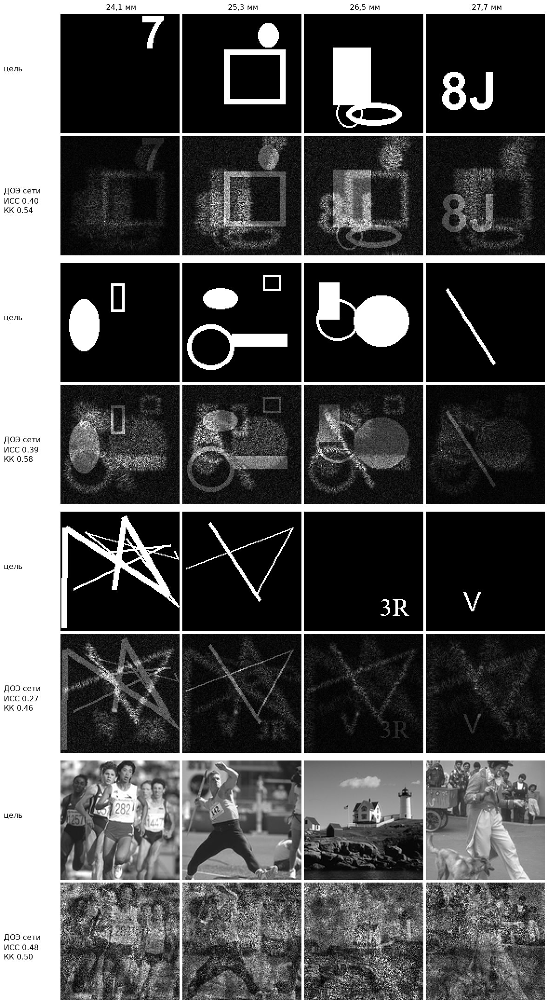

# Нейросетевой синтез фазовых ДОЭ

Сеть по четырём изображениям 128×128 за **один прямой проход** синтезирует фазовый дифракционный оптический элемент (ДОЭ). При дифракции Френеля на расстояниях 24,1 / 25,3 / 26,5 / 27,7 мм (λ = 532 нм, пиксел ПВМС 10 мкм) этот ДОЭ восстанавливает в каждой плоскости своё изображение.

## Быстрый старт (Docker)

```bash
docker build -t doe-generation .

# CPU
docker run --rm -v "$(pwd)/examples:/data/input" -v "$(pwd)/out:/data/output" doe-generation

# GPU (нужен NVIDIA Container Toolkit)
docker run --rm --gpus all -v "$(pwd)/examples:/data/input" -v "$(pwd)/out:/data/output" doe-generation
```

В Windows PowerShell вместо `$(pwd)` используйте `${PWD}`.

### Вход

Папка `/data/input` устроена одним из двух способов:
- **подпапки-комплекты**, в каждой по 4 изображения (PNG, 128×128, 8 бит, оттенки серого);
- **ровно 4 изображения** прямо в папке, то есть один комплект;
- **несколько комплектов в одной папке** (8, 12, 20… файлов). Они группируются по общему началу имени (`set1_24.1mm.png`, `set2_24.1mm.png`…), иначе по номеру при одинаковом расстоянии (`24.1mm_1.png`, `25.3mm_1.png`…), иначе по 4 файла подряд в алфавитном порядке.

Порядок плоскостей берётся из расстояния в имени файла (`01_24.1mm.png`, `…25.3…`, `…26.5…`, `…27.7…`). Если расстояния в имени нет, файлы сортируются по алфавиту.

### Выход (`/data/output`)

| Файл | Содержимое |
|---|---|
| `<комплект>.png` | **ДОЭ**: 128×128, 8 бит, оттенки серого; 0 → −π, 255 → +π |
| `<комплект>/rec_*.png` | 4 восстановленных изображения, рассчитанные по ДОЭ (амплитуда, нормировка на максимум) |
| `<комплект>/metrics.json` | ИСС и КК по каждой плоскости, время работы сети |
| `results.csv`, `results.json` | Метрики по всем комплектам, средние значения и время |

Восстановление и метрики считаются по PNG ДОЭ, **прочитанному с диска**: прямой БПФ, центрированная сетка (`ifftshift → fft2 → fftshift`), то есть так же, как при проверке.

### Без Docker

```bash
pip install -r requirements.txt
python run.py --input examples --output out
```

## Метод

Модель `UnrolledDOENet` (`doe/core.py`) — **развёрнутая физически-информированная нейросеть** (deep unfolding). В ней 24 физических слоя, у каждого свои веса. Каждый слой работает так:

1. Распространяет текущее поле ДОЭ в 4 плоскости точным расчётом Френеля (один БПФ).
2. Свёрточная сеть (5 свёрток, 48 каналов, расширенные свёртки) **совместно** анализирует все 4 плоскости: цель, текущую амплитуду, ошибку. По этому анализу она предсказывает желаемую амплитуду и фазовую поправку в каждой плоскости.
3. Обратный Френель переносит поле на ДОЭ, вклады плоскостей суммируются с обучаемыми весами, фаза обновляется с обучаемыми шагом и инерцией.

За физическими слоями следуют **48 слоёв уточнения**. Каждый из них делает шаг по градиенту метрики качества (ИСС + КК по амплитудам) с нормировкой по пикселям, как в Adam, а размер шага у каждого слоя обучаемый. Всего в сети 72 слоя, их число фиксировано для любого входа.

Физика встроена в сеть, поэтому сети не нужно заново учить дифракцию. Обучаемая часть отвечает за стратегию: как развести четыре изображения по близким плоскостям и где допустить шум. **На этапе применения — один прямой проход сети фиксированной глубины (72 слоя)**: без внешнего оптимизатора, без итераций «до сходимости» и без подбора каких-либо параметров под конкретный вход.

**Обучение** (`train.py`): функция потерь — непосредственно метрика оценки, `1 − (0.3·КК + 0.7·ИСС)`, по амплитудам, нормированным на максимум. Фаза при этом округляется до 8 бит, как в сдаваемом PNG (straight-through-оценка градиента). Данные генерируются на лету: символы, фигуры, кольца, линии, полутоновые версии и фрагменты фотографий. Перед обучением симулятор сверен с физическими параметрами задачи.

## Результаты

<!-- RESULTS -->

| Набор | Метод | ИСС | КК |
|---|---|---:|---:|
| Синтетика (dataset_v1/val), 128 компл. | Гершберг–Сэкстон, 50 итераций | 0.311 | 0.540 |
| Синтетика (dataset_v1/val), 128 компл. | **Наша сеть, один проход** | **0.363** | **0.543** |
| Фотографии (BSDS500 test), 32 компл. | Гершберг–Сэкстон, 50 итераций | 0.398 | 0.455 |
| Фотографии (BSDS500 test), 32 компл. | **Наша сеть, один проход** | **0.489** | **0.518** |

| Время синтеза одного ДОЭ | GPU (RTX 2070 Super) | CPU (4 потока) |
|---|---:|---:|
| Наша сеть (замер внутри Docker, `run.py`) | 0.35–0.6 с | 0.76–0.9 с |
| Наша сеть (без Docker, батч 1) | 0.30 с | — |
| Гершберг–Сэкстон, 50 итераций | 0.03 с | 0.17 с |

Оба набора сеть при обучении не видела. Метрики считаются по амплитудам, нормированным на максимум, после записи фазы ДОЭ в 8-битный PNG, и усредняются по 4 плоскостям.

Для справки: прямая итерационная оптимизация под эту же метрику (~1000 итераций Adam на каждый комплект) даёт на синтетике ИСС ≈ 0.37–0.39. Это практический предел для данной физики (плоскости разнесены всего на 1.2 мм). Сеть почти достигает его за один проход, а по ИСС опережает классический метод на 0.05 (синтетика) и 0.09 (фото).


<!-- /RESULTS -->

## Структура

```
run.py              синтез ДОЭ для всех комплектов (точка входа Docker)
train.py            обучение
doe/core.py         физика Френеля, метрики, сеть, генератор обучающих данных
tools/finalize.py   оценка модели, сравнение с Гершбергом–Сэкстоном, таблица результатов
weights/model.pt    обученные веса
examples/           примеры комплектов для проверки
results/            итоговые метрики (summary.json) и картинка примеров
presentation/       презентация
```

## Воспроизведение обучения

Обучение шло в два этапа на одной RTX 2070 Super. Обучающие данные генерируются на лету; `--val` и `--photos` нужны только для контроля и необязательны.

```bash
# этап 1: 24 физических слоя (лучшая точка — шаг 2000)
python train.py --run runs/stage1 --refine 0 --hours 8 --lr 3e-4 --eval-every 500 --val <папка с четвёрками> --photos <папки с фото>

# этап 2: + 48 слоёв уточнения, дообучение от весов этапа 1 (6 ч)
python train.py --run runs/stage2 --init runs/stage1/best.pt --refine 48 --hours 6 --lr 1e-4 --eval-every 500 --val <папка с четвёрками> --photos <папки с фото>

cp runs/stage2/best.pt weights/model.pt
```
